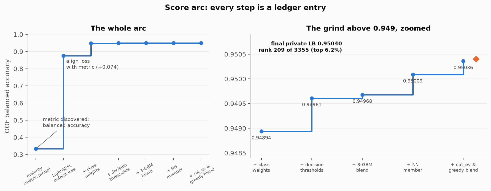
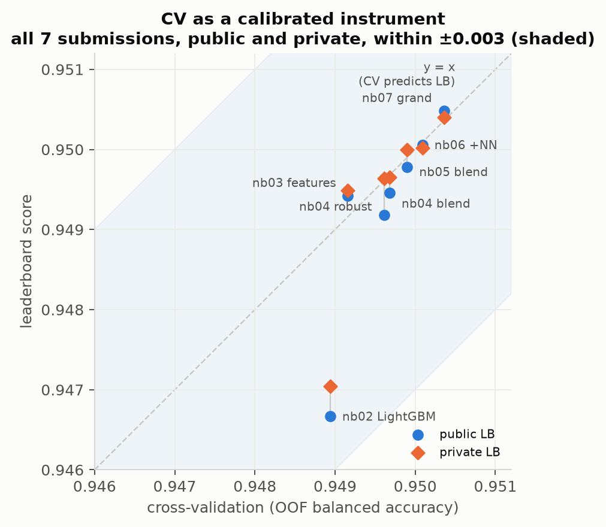
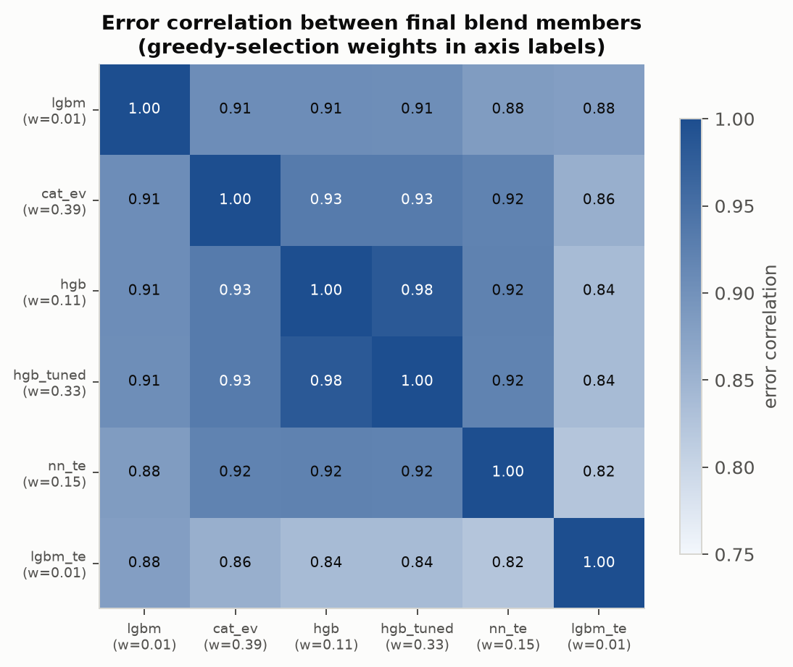

# Kaggle Playground S6E7 — Predicting Student Health Risk

A hypothesis-driven run at [Kaggle Playground S6E7](https://www.kaggle.com/competitions/playground-series-s6e7):
3-class classification of student health condition (86% / 8.4% / 5.8% class split, 690k rows,
13 features with heavy missingness), scored by **balanced accuracy**.

**Final: public LB 0.95048 — top 15.5% of 2,192 teams — with every point of the score
accounted for in an [experiment ledger](experiments.md).** Thirteen logged experiments,
five falsified hypotheses, seven submissions, and a cross-validation setup that never
missed the leaderboard by more than 0.003.



| Stage | Score | What earned it |
|---|---|---|
| Majority baseline (metric probe) | 0.333 | Discovered the metric is balanced accuracy, not accuracy |
| LightGBM, default loss | 0.875 | A GBM with sane defaults |
| + class-weighted loss | 0.949 | **Align objective with metric** (+0.074, the biggest lever) |
| + features / + tuning | 0.949 | Two measured zeros — honest redirects, not failures |
| + per-class thresholds | 0.9496 | **Align decision rule with metric** |
| + cross-implementation blend | 0.9498 | Implementation diversity (CatBoost, HistGradientBoosting) |
| + torch NN member | 0.9501 | Function-class diversity |
| + CatBoost-native exact-value TE + greedy blend | **0.9505** | The one verified feature edge, encoded the tree-safe way |

## The method

**Probe the metric before trusting it.** The first submission predicted the majority class
for every row — not as a throwaway, but as an experiment: plain accuracy predicted a 0.859
score, balanced accuracy predicted exactly ⅓. It scored 0.33333. One submission falsified
the wrong belief and reshaped the entire strategy (notebook 01, §9).

**Treat cross-validation as an instrument, and calibrate it.** One fixed 5-fold stratified
assignment, persisted to disk and asserted identical in every later notebook. Every model
reports out-of-fold balanced accuracy on those folds; the fold spread sets the noise floor
(±0.0005) that decides what counts as a real improvement.



**Run everything as a ledger.** Every idea enters [experiments.md](experiments.md) as
*hypothesis → one change → CV → keep/drop*. Keepers must clear the noise floor; drops are
logged with the same care because a falsified hypothesis about this dataset is knowledge.
The ledger's two zero-rows (feature engineering, hyperparameter tuning) redirected effort
to where the score actually lived: alignment and diversity.

**Alignment before sophistication.** The two largest gains were not clever models — they
were making the training loss (+0.074, class weights) and the decision rule (+0.0014,
per-class thresholds fit on OOF probabilities) match the metric. By the final ensemble,
the threshold search converged to exactly 1.0: alignment had migrated into the members.

**Then buy diversity — and price it honestly.** Blending only pays when members make
different mistakes. The final greedy-selected committee weights quality *and*
decorrelation; two "failed" models (a LightGBM hurt by naive target encoding, weight 0.01;
a below-par NN, weight 0.15) still earn places on decorrelation value alone.



## The story in 7 notebooks

| Notebook | One-line finding |
|---|---|
| [01 — EDA + baseline](notebooks/01-eda.ipynb) | `stress_level` nearly determines the minority classes; `bmi` missingness is itself a signal; the baseline probe exposes the real metric |
| [02 — CV harness](notebooks/02-baseline-cv.ipynb) | The metric defines the model: class weights trade 5 points of majority recall for 12–15 on each minority — plain accuracy hates it, balanced accuracy pays +0.074 |
| [03 — Feature experiments](notebooks/03-features.ipynb) | Five hypotheses, zero keepers; naive imputation destroys 4 points by erasing the missingness signal |
| [04 — Tuning, thresholds, ensemble](notebooks/04-final.ipynb) | Tuning loses to defaults, but its better-*ranked* probabilities win once thresholds are applied — compare models under the deployed decision rule |
| [05 — More members, stacking](notebooks/05-stacking.ipynb) | Implementation diversity beats parameter search; diversity only pays above a quality floor |
| [06 — NN + competitor intelligence](notebooks/06-headroom.ipynb) | Exact-value target encoding: −0.0044 on a tree, +0.0001 on an MLP — features and function classes are a joint hypothesis |
| [07 — Final push](notebooks/07-final-push.ipynb) | CatBoost's ordered target statistics encode the same features *safely* (+0.0006, best single model); greedy selection prices an 8-member committee |

## Lessons the ledger paid for

1. **Probe the metric before trusting it.** One "dumb" submission distinguished accuracy from balanced accuracy and reshaped the whole strategy.
2. **Alignment beats sophistication.** Loss↔metric (class weights) and decision-rule↔metric (thresholds) earned more than every clever idea combined.
3. **A CV you trust is the actual asset.** Fixed folds, OOF everything; seven submissions, never off by more than 0.003.
4. **Negative results are purchases.** Imputation −0.041 (destroys missingness signal), feature ladder 0, tuning ≤0 three times — each redirected effort with evidence.
5. **Features and function classes are a joint hypothesis.** Exact-value target encoding: −0.0044 on LightGBM, +0.0001 on our MLP, **+0.0006 via CatBoost's ordered statistics** — same idea, three outcomes.
6. **Diversity pays only above a quality floor.** Weak-but-different members were zeroed by every combiner; the committee prices contribution, not novelty.

## How this was built

This project was a deliberate experiment in AI-paired ML: I worked with Claude
(via Claude Code) in an *explain-as-we-build* arrangement — Claude wrote the code and
analysis and proposed hypotheses; I set the direction, questioned the reasoning at every
milestone checkpoint, and made every go/no-go call, from the metric-probe strategy to
which experiments were worth compute to when to stop. The workflow that made this
productive — spec → plan → milestones, the ledger contract, artifact caching, parallel
training runs, a competitor-scouting agent — is documented in [WORKFLOW.md](WORKFLOW.md).

## Reproduce

```bash
uv sync                                   # main env (py3.13)
uv venv --python 3.12 .venv-torch         # torch side-env (Intel-mac torch 2.2.2)
VIRTUAL_ENV=.venv-torch uv pip install "torch==2.2.2" "numpy==1.26.4" \
    "scipy==1.13.1" "scikit-learn==1.5.2" "pandas==2.2.3" pytabkit
kaggle competitions download playground-series-s6e7 -p data && unzip -d data data/*.zip
# notebooks in order (02+ cache heavy results to artifacts/); torch jobs:
.venv-torch/bin/python src/train_nn.py    # etc.
uv run python src/make_figures.py         # regenerate README figures
```

Repo layout:

```
notebooks/01..07     the analysis, in order — written to be read
experiments.md       the complete hypothesis ledger (E1–E13)
src/                 training scripts for the heavy jobs + figure generation
docs/superpowers/    design specs and implementation plans (process artifacts)
assets/              README figures (generated, not drawn)
```
